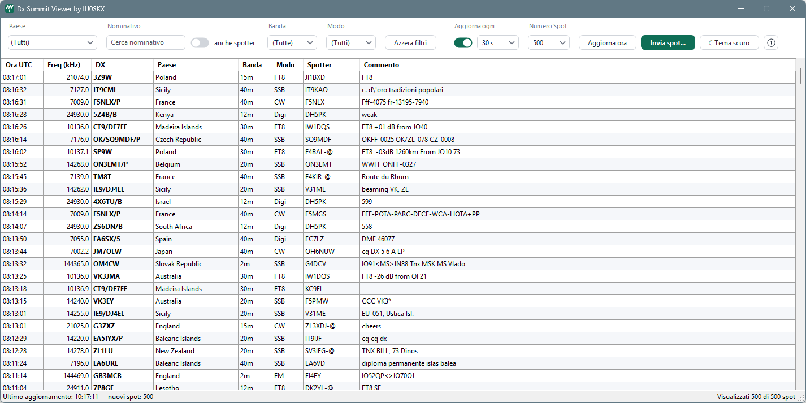
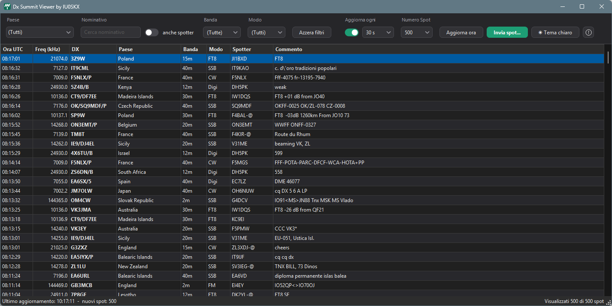

# Dx Summit Viewer

Applicazione per Windows che mostra in tempo reale gli spot del cluster [DX Summit](https://www.dxsummit.fi/), con filtri per paese, nominativo, banda e modo e la possibilità di inviare nuovi spot.

Un solo file `.exe` di circa 150 KB, senza installazione e senza dipendenze esterne.



<details>
<summary>Tema scuro</summary>



</details>

## Funzionalità

- **Lista autoaggiornante**: gli spot si aggiornano da soli (15 s, 30 s, 1 min, 2 min, 5 min o 10 min) oppure con il pulsante *Aggiorna ora*. Gli spot arrivati con l'ultimo aggiornamento sono evidenziati.
- **Filtro per paese**: menu con i paesi presenti negli spot, con suggerimento mentre si scrive. Accetta anche i nomi in italiano (*Italia*, *Sicilia*, *Sardegna*). Selezionando *Italy* vengono inclusi anche Sicily, Sardinia e African Italy.
- **Ricerca per nominativo**: cerca nel nominativo DX e, attivando *anche spotter*, anche tra chi ha inviato lo spot.
- **Filtro per banda**: da 2200m a 23cm.
- **Filtro per modo**: CW, SSB, FT8, FT4, RTTY, PSK, Digi, FM, AM, SSTV.
- **Invio di spot** a DX Summit, con conferma prima dell'invio. Il proprio nominativo viene ricordato.
- **Menu con il tasto destro** su uno spot: copia nominativo o frequenza, apri il nominativo su QRZ.com, spotta di nuovo lo stesso DX, filtra per quel paese. Il doppio clic copia il nominativo.
- **Tema chiaro e scuro**, con la scelta ricordata al successivo avvio.
- Colonne ordinabili cliccando sull'intestazione. Lo spot selezionato resta selezionato anche dopo gli aggiornamenti.

## Requisiti

- Windows 10 o Windows 11
- .NET Framework 4.x, già incluso in Windows 10 e 11
- Connessione a internet

## Installazione

1. Scaricare `DXSummitViewer.exe` dalla pagina [Releases](../../releases).
2. Avviarlo con un doppio clic. Non serve installare nulla.

> **Nota:** l'eseguibile non ha una firma digitale, quindi al primo avvio Windows SmartScreen potrebbe mostrare l'avviso *"Windows ha protetto il PC"*. Per avviarlo comunque: *Ulteriori informazioni* → *Esegui comunque*.

## Come vengono determinati banda e modo

L'API di DX Summit fornisce la frequenza ma non il modo di emissione.

- La **banda** viene calcolata dalla frequenza.
- Il **modo** viene ricavato in quest'ordine:
  1. dalle parole chiave nel commento dello spot (`FT8`, `CW`, `SSB`, `RTTY`…);
  2. dalle frequenze standard FT8 e FT4;
  3. dal band plan IARU.

Per gli spot senza indicazioni nel commento il modo è quindi una stima.

## Impostazioni salvate

Il programma salva solo il proprio nominativo (per l'invio degli spot) e il tema scelto, in file di testo nella cartella:

```
%APPDATA%\DXSummitViewer\
```

## Compilare dai sorgenti

Non servono Visual Studio né il .NET SDK: basta il compilatore C# incluso in .NET Framework 4.x, presente in ogni installazione di Windows.

```bat
build.bat
```

Lo script produce `DXSummitViewer.exe` nella stessa cartella.

Per modificare l'icona, cambiare il disegno in `MakeIcon.cs` e rigenerare `app.ico` prima di ricompilare:

```bat
make_icon.bat
build.bat
```

### Struttura del progetto

| File | Contenuto |
|---|---|
| `DXSummitViewer.cs` | Finestra principale, lettura e filtro degli spot, invio spot, tema, finestra Informazioni |
| `UiControls.cs` | Controlli disegnati a mano che seguono il tema (menu a tendina, campi, interruttori, pulsanti) |
| `MakeIcon.cs` | Generatore dell'icona `app.ico` |
| `app.ico` | Icona dell'applicazione (16–256 px) |
| `build.bat` | Compila l'eseguibile |
| `make_icon.bat` | Rigenera l'icona |
| `docs/` | Screenshot usati in questo README |

## Fonte dei dati

Gli spot provengono dall'API pubblica di DX Summit:

- `GET https://new.dxsummit.fi/api/v1/spots?limit=N`: elenco degli spot più recenti
- `POST https://new.dxsummit.fi/api/v1/spots`: invio di un nuovo spot (`de_call`, `dx_call`, `frequency`, `info`)

Questo progetto non è affiliato a DX Summit né a OH8X.

## Crediti

- Dati: [DX Summit](https://www.dxsummit.fi/) di OH8X
- Icona dell'applicazione e icona *info*: basate sulle icone [Lucide](https://lucide.dev/) (licenza ISC)

## Autore

**IU0SKX**: segnalazioni e suggerimenti sono benvenuti tramite le [Issues](../../issues).

73!
